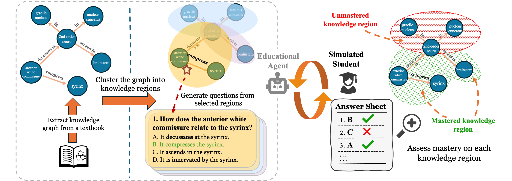

<h1 align="center">SAGE: A Synthetic Graph Benchmark for Personalized Student Knowledge-State Modeling</h1>

  Manzi Fabrice Niyigaba · Xuyuan Liu · Thomas Thesen · Yujun Yan 
  Dartmouth College

  

**Overview of the SAGE framework.** An educational agent extracts a knowledge graph from educational materials, partitions it into overlapping knowledge regions, and generates region-grounded questions. These questions are given to simulated students with diverse knowledge profiles, whose responses are used to estimate mastered and unmastered regions and recover each learner's latent knowledge state under limited interaction budgets.

## Repository Structure

| Directory | Purpose |
| --- | --- |
| [Data](Data/) | This is where pipeline artifacts live and are saved by default. We additionally provide four graphs and their clusters used in our paper, plus one smaller graph for faster iterations. |
| [GraphConstruction](GraphConstruction/) | Takes educational `.txt` notes, uses [**kg-gen**](https://github.com/stair-lab/kg-gen) to create a knowledge graph, cleans it, and converts it into a line graph. We recommend checking the generated graph, since its quality is crucial to performance. You can refine the cleaning rules in [clean.py](GraphConstruction/clean.py). |
| [GraphClustering](GraphClustering/) | Takes the line graph and performs clustering to generate overlapping knowledge concept clusters. |
| [QuestionGeneration](QuestionGeneration/) | Takes the generated clusters and few-shot questions to generate cluster-specific questions for assessment. |
| [StudentSimulation](StudentSimulation/) | Uses generative students to simulate student behavior and graph propagation to spread the signal further, recovering the underlying student knowledge state with few queries. |

## Model Configuration

In our experiments, we used `gpt-oss-120b`. To use a different model, update the model settings in [GraphConstruction](GraphConstruction/configurations/main.yaml), [QuestionGeneration](QuestionGeneration/configurations/main.yaml), or [StudentSimulation](StudentSimulation/configurations/main.yaml), and provide its API key through the configured environment variable.

## Correspondence

Questions and bug reports: [fabrice.27@dartmouth.edu](mailto:fabrice.27@dartmouth.edu).
